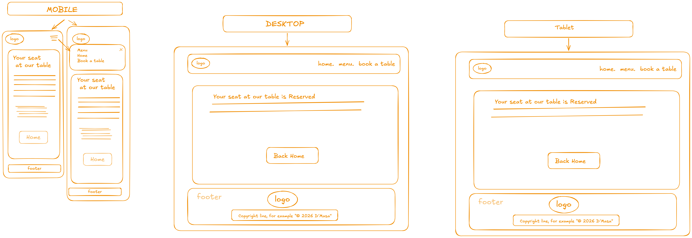
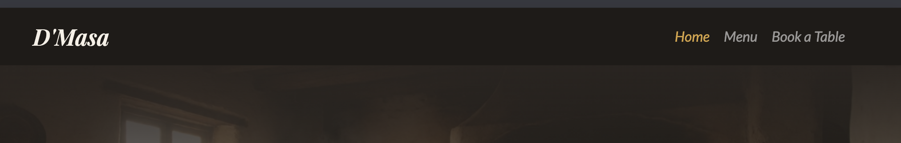
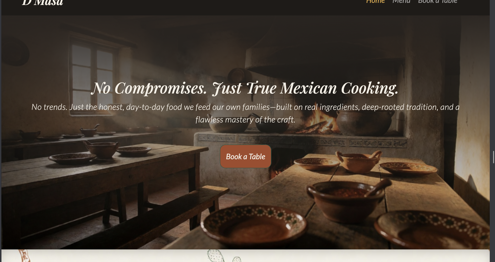
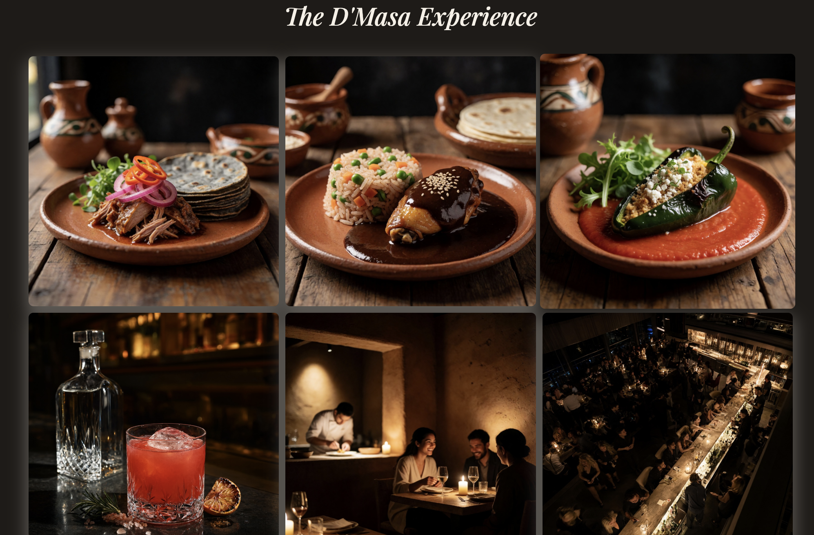
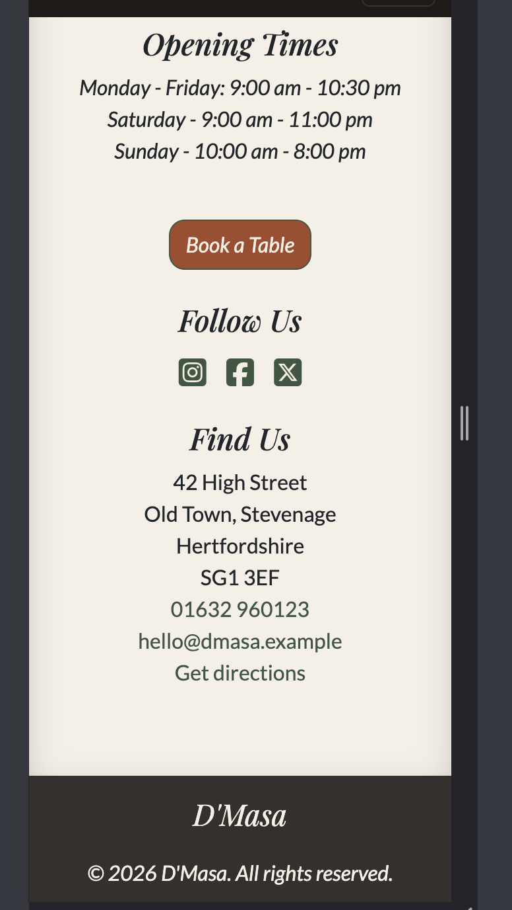
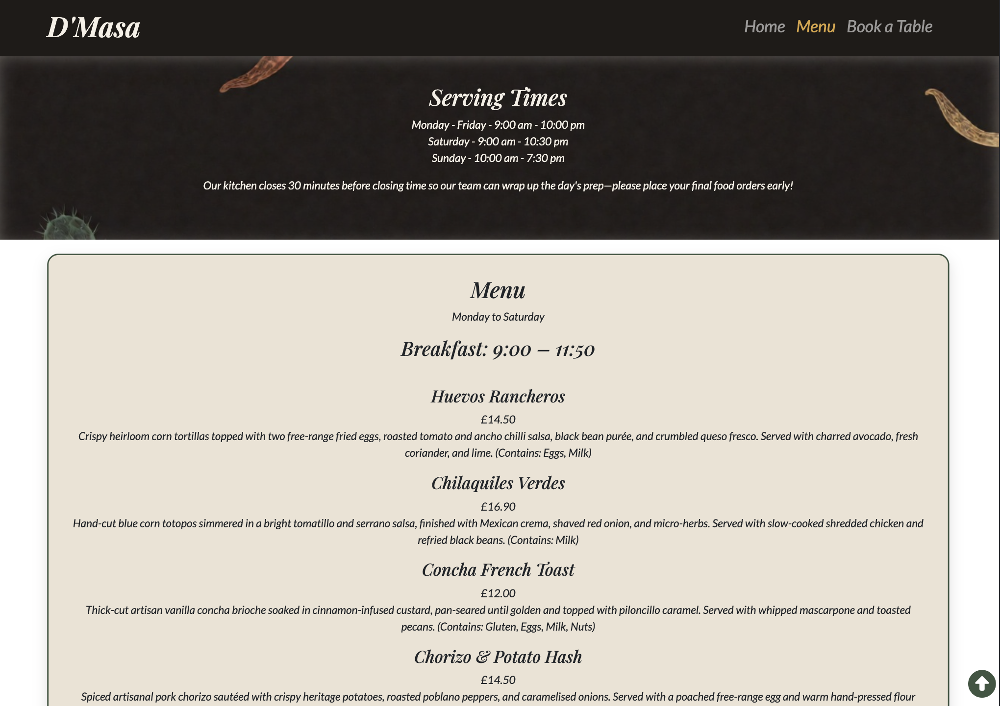
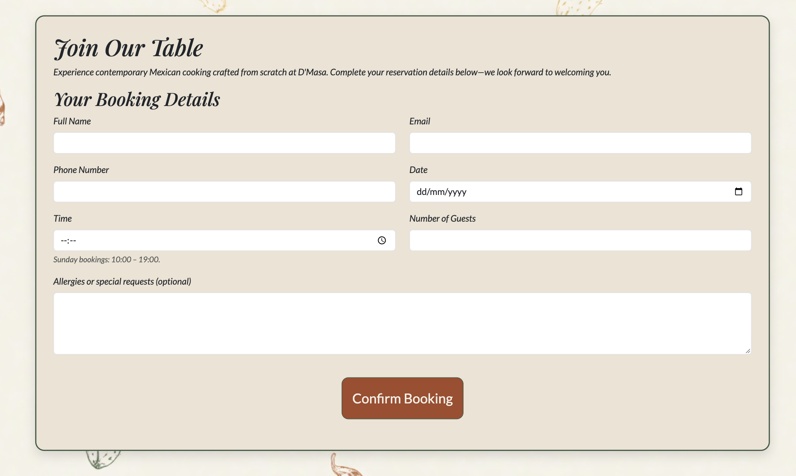
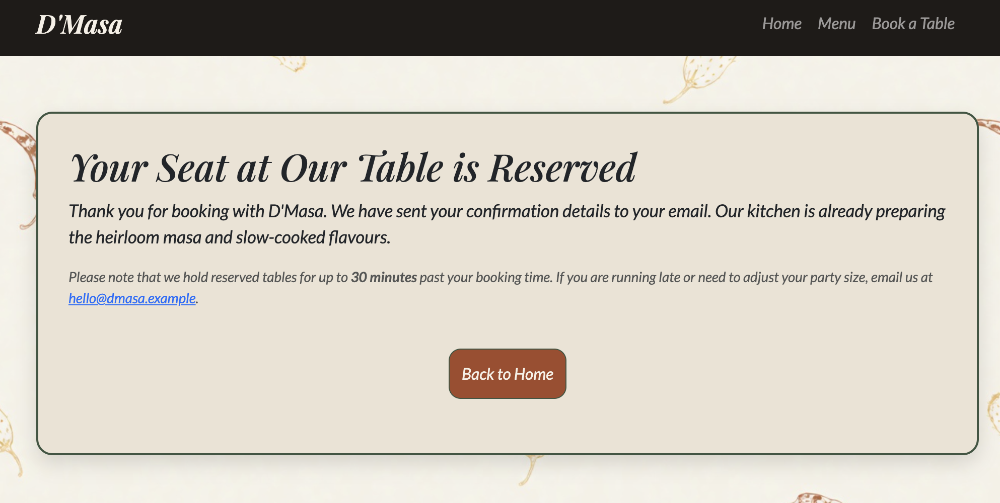

# D'Masa | Modern Mexican Restaurant
Static website for D’Masa, a modern Mexican restaurant. Built with HTML, CSS and Bootstrap.

# D'Masa | Modern Mexican Restaurant

[View the live site here](https://luis-lucas.github.io/d-masa-mexican-restaurant/)

D'Masa is a modern, refined Mexican restaurant, inspired by the traditions and techniques of Mexico's first peoples and its modern cooks, and by the country's diverse regional cuisine. At D'Masa, food is enjoyed as a ritual, not just as fuel.

This website gives users a small window into the everyday Mexican food experience, with a modern touch and refined techniques. It allows users to explore the menu, check the opening times, find the restaurant, get in touch, and book a table.

For the site owner, the website is designed to turn visits into bookings. The user experience follows a natural flow, so booking a table never feels like a forced decision, but rather an opportunity: more convenience for the customer, and more bookings for the restaurant.

## UX / Design

## User Stories

#### New, Returning and Frequent Users
- As a **new user**, I want to see the food on offer, the atmosphere, the location and the opening hours, so that I can decide whether to book a table.
- As a **returning user**, I want to quickly check information I've forgotten, like the location or opening times, so that I can easily book a table again.
- As a **frequent user**, I want to follow D'Masa on social media, so that I can keep up with new dishes and special events.

### Customer
- As a customer, I want to book a table for dinner, so that I can enjoy a meal with my friends or girlfriend without waiting.
- As a customer, I want to know the opening and closing times, so that I can agree with my group on a good time to go.
- As a customer, I want to see the lunch, dinner and Sunday brunch menus, so that I can decide if we like what’s on offer.
- As a customer, I want to see what the restaurant looks like inside and outside, so that I feel familiar with it and can show my friends or girlfriend.
- As a customer, I want to know if I need a reservation or can just walk in, so that I can choose whether to plan ahead or go spontaneously.

### Site Owner
- As the site owner, I want to show our opening hours, so that customers know when they can come and dine with us.
- As the site owner, I want to show our menu, so that customers can see the delicious food and drinks we offer.
- As the site owner, I want to show our atmosphere, so that customers feel enticed to come and be part of the experience.
- As the site owner, I want to encourage customers to book a table, so that the website brings in business and makes booking easy for customers.

## Design

The design of D'Masa is inspired by the colours and textures of Mexico, especially Michoacán: its clay pottery, its copper work, and the colours of masa and nopal.

### Colours

| Colour | Hex | Inspiration | Used for |
| --- | --- | --- | --- |
| Obsidian | `#1F1B18` | Volcanic obsidian stone | Text, navbar, dark sections |
| Masa | `#F6F0E6` | Fresh corn dough | Page backgrounds, light text |
| Masa dark | `#ECE3D4` | Toasted masa | Menu and booking cards |
| Barro | `#A34A2A` | Michoacán clay pottery | Book a Table buttons |
| Nopal | `#3E5641` | Nopal cactus | Links, borders, icons |
| Maíz | `#D9A441` | Golden corn | Active link, menu dividers |

All colours were checked for contrast to meet accessibility guidelines (see [TESTING.md](TESTING.md)).

### Fonts

- **Playfair Display** is used for headings. Its elegant style reflects the professionalism that goes into creating D'Masa's menu and dishes, and the refined atmosphere of the restaurant.
- **Lato** is used for all other text. It's clean and easy to read on every screen size, while its warmth reflects the colour and full-of-life attitude of Mexican culture.

### Design Decisions

- **Reusable elements:** styles like the Book a Table button (`.btn-book`), the paper card (`.paper-card`) and the section shadow (`.section-shadow`) are reused across the site, so it feels connected page by page, like a single website rather than a collection of separate pages.
- **Pre-footer and bottom footer:** the footer is split into two parts, which gives flexibility when developing, improving or extending the site.

The final site follows these wireframes closely. A few changes were made during development: the mobile menu was changed from a dropdown to a side panel (offcanvas) for a cleaner look, and the Booking and Success page wireframes were finalised during development, as the form layout evolved while building.

## Features

### Navigation Bar
A fixed navbar on every page, with links to Home, Menu and Book a Table. The current page is highlighted in gold. On mobile, the links are in a side menu opened by a burger icon.

### Hero Section
A full-width image of a rustic Mexican kitchen, with the restaurant's message and a Book a Table button, so new users immediately understand what D'Masa is.

### Gallery
Six photos showing the food and the atmosphere of the restaurant, with a gentle hover effect.

### Pre-footer and Footer
Opening times, address, phone, email, directions and social media links, on every page where customers are planning their visit.

### Menu Page
A banner with buttons that jump straight to the Monday–Saturday or Sunday menu, the serving times, and the menus presented on paper-style cards, with allergens listed for each dish. A back to top button helps users on this long page.

### Booking Form
A form that checks every field before sending, so customers can't book with missing or incorrect details.

### Success Page
A confirmation message after booking, with a button back to the Home page.

### Future Features
- A drinks menu and dessert menu
- A customer reviews section
- **Automatic booking dates and times:** the date field currently only allows bookings from 16/11/2026, and this doesn't update by itself. Using JavaScript, the earliest date could update to today's date automatically, and the time field could follow each day's opening hours.

## Technologies Used

### Languages
- HTML5
- CSS3

### Frameworks, Libraries and Tools
- [Bootstrap 5.3](https://getbootstrap.com/) for the responsive layout, navbar and form styling
- [Font Awesome](https://fontawesome.com/) for the social media and back to top icons
- [Google Fonts](https://fonts.google.com/) for the Playfair Display and Lato fonts
- [Git](https://git-scm.com/) for version control
- [GitHub](https://github.com/) to store the code
- [GitHub Pages](https://pages.github.com/) to host the live site
- [Visual Studio Code](https://code.visualstudio.com/) as the code editor
- [Excalidraw](https://excalidraw.com/) for the wireframes
- [favicon.io](https://favicon.io/) to create the favicon
- [Chrome DevTools](https://developer.chrome.com/docs/devtools/) and Lighthouse for testing
- [Claude](https://claude.ai/) (Anthropic's AI assistant) as a learning assistant for code review, debugging and spelling
- Artistly AI to generate the photos and background patterns

## Deployment

### Deploying to GitHub Pages

The site was deployed to GitHub Pages using these steps:

1. In the GitHub repository, click the **Settings** tab.
2. In the left menu, click **Pages**.
3. Under **Build and deployment**, set **Source** to **Deploy from a branch**.
4. Under **Branch**, select **main** and the **/ (root)** folder, then click **Save**.
5. After a minute or two, refresh the page. A link to the live site appears at the top.

The live site can be found here: [D'Masa](https://luis-lucas.github.io/d-masa-mexican-restaurant/)

After deployment, the live site was tested to make sure it matches the development version (see [TESTING.md](TESTING.md)).

### Running the Project Locally

To make a copy of this project on your own computer:

1. Go to the [GitHub repository](https://github.com/luis-lucas/d-masa-mexican-restaurant).
2. Click the green **Code** button, and copy the **HTTPS** link.
3. Open a terminal, and go to the folder where you want to save the project.
4. Type `git clone` followed by the link you copied, and press **Enter**:

   `git clone https://github.com/luis-lucas/d-masa-mexican-restaurant.git`

5. Open the project folder in your code editor, and open `index.html` in a browser (or use an extension like Live Server) to view the site.

### Forking the Repository

To make your own copy of the repository on GitHub, without affecting the original:

1. Go to the [GitHub repository](https://github.com/luis-lucas/d-masa-mexican-restaurant).
2. Click the **Fork** button in the top right corner.
3. A copy of the repository will be created in your own GitHub account.