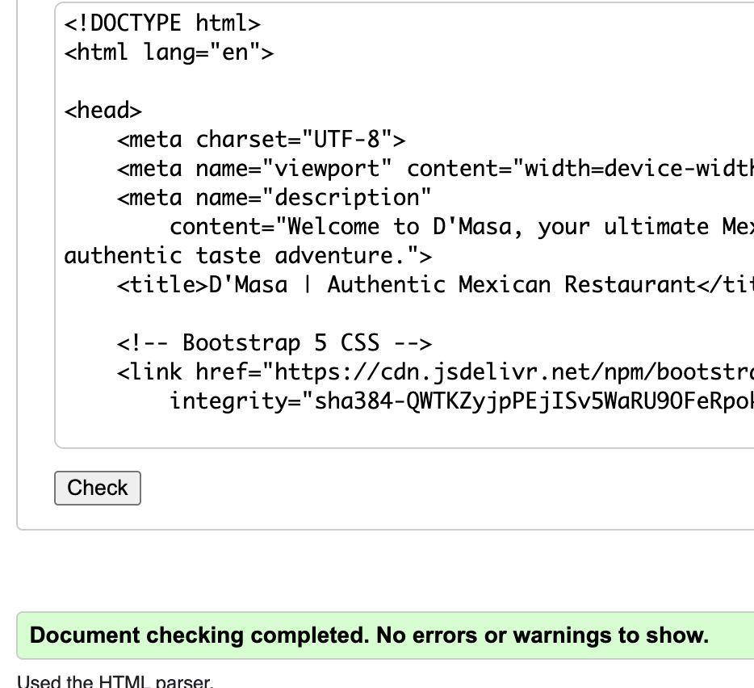
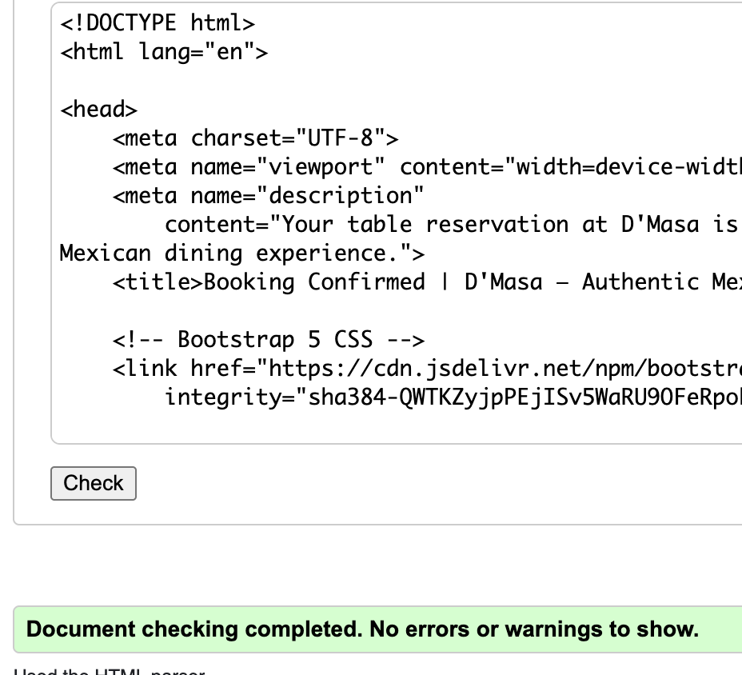

# Testing D'Masa

## Validators

To check the code, I used two official online validators:

- [W3C Markup Validation Service](https://validator.w3.org) for the HTML
- [W3C CSS Validation Service (Jigsaw)](https://jigsaw.w3.org/css-validator/) for the CSS

### HTML

I ran each page through the HTML validator, expecting no errors. On the first run, the validator showed that the `aria-labelledby` attribute is not allowed on a `div`. This came from the Bootstrap offcanvas navbar code. I checked the error with Claude AI and found the fix, which was to add `role="dialog"` to the offcanvas `div`.
I then ran the validator on the Menu page, and it showed three errors on the same line. They were all caused by a missing closing quote after `class="nav-link`, which merged the `class` and `href` attributes and broke the "Book a Table" link in the navbar. I added the missing quote (`class="nav-link"`), and the errors disappeared.
Next, I ran the validator on the Booking page, and it flagged an error: the page went straight from the `h1` to the `h3` headings in the pre-footer, skipping a heading level. My original design didn't need an `h2` on this page, so I added a new heading, "Your Booking Details", above the form. This fixed the error and also helps introduce the form to customers.

After these fixes, all four pages passed the HTML validator with no errors.

## Lighthouse

## Responsiveness

## Browser Compatibility

## Manual Testing

## Bugs