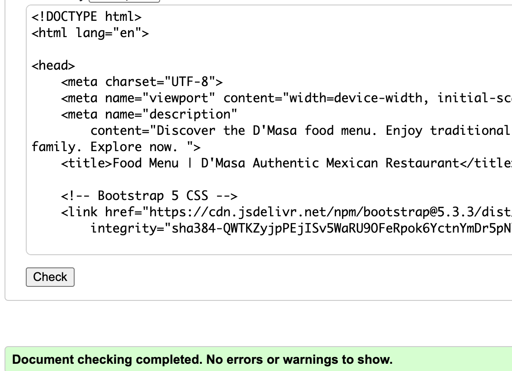
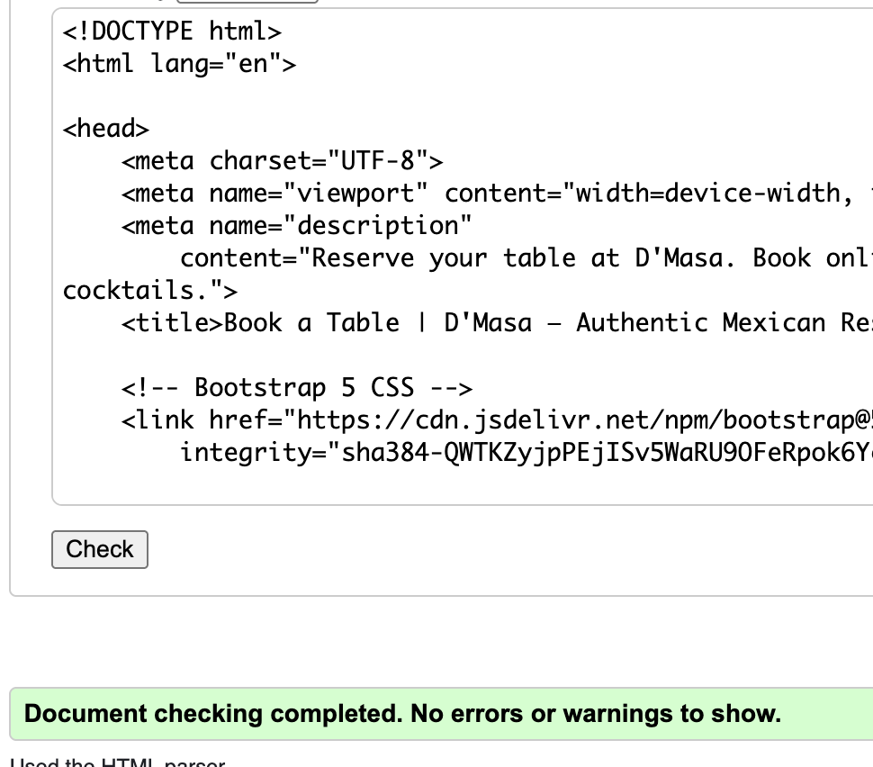
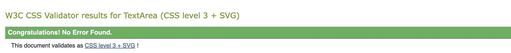

# Testing D'Masa

## Validators

To check the code, I used two official online validators:

- [W3C Markup Validation Service](https://validator.w3.org) for the HTML
- [W3C CSS Validation Service (Jigsaw)](https://jigsaw.w3.org/css-validator/) for the CSS

### HTML

I ran each page through the HTML validator, expecting no errors. On the first run, the validator showed that the `aria-labelledby` attribute is not allowed on a `div`. This came from the Bootstrap offcanvas navbar code. I checked the error with Claude AI and found the fix, which was to add `role="dialog"` to the offcanvas `div`.
I then ran the validator on the Menu page, and it showed three errors on the same line. They were all caused by a missing closing quote after `class="nav-link`, which merged the `class` and `href` attributes and broke the "Book a Table" link in the navbar. I added the missing quote (`class="nav-link"`), and the errors disappeared.
Next, I ran the validator on the Booking page, and it flagged an error: the page went straight from the `h1` to the `h3` headings in the pre-footer, skipping a heading level. My original design didn't need an `h2` on this page, so I added a new heading, "Your Booking Details", above the form. This fixed the error and also helps introduce the form to customers.

After these fixes, all four pages passed the HTML validator with no errors.

### CSS

I ran my `style.css` file through the CSS validator, and as expected, it passed with no errors. The validator showed 4 warnings about CSS variables. These warnings are only informational: the validator can't check the values inside CSS variables (like `var(--color-masa)`), because they can change while the page runs. They don't indicate any problem with the code.

## Lighthouse

I tested every page with Lighthouse in Chrome DevTools, on both mobile and desktop. Testing was a bit of a rollercoaster, but in the end it all worked out well. Along the way, I used Claude AI to help me understand what some of the errors meant and how to fix them.

| Page | Device | Performance | Accessibility | Best Practices | SEO |
| --- | --- | --- | --- | --- | --- |
| Home | Mobile | 77 | 100 | 100 | 100 |
| Home | Desktop | 98 | 100 | 100 | 100 |
| Menu | Mobile | 75 | 100 | 100 | 100 |
| Menu | Desktop | 99 | 100 | 100 | 100 |
| Booking | Mobile | 88 | 100 | 100 | 100 |
| Booking | Desktop | 99 | 100 | 100 | 100 |
| Success | Mobile | 89 | 95 | 100 | 100 |
| Success | Desktop | 99 | 96 | 100 | 100 |

### Fixes made

- **Image sizes:** the gallery images had no `width` and `height` set, which caused the page to jump around while loading. I added both attributes, plus `loading="lazy"`, and the Home page performance went from 89 to 96.
- **Button contrast:** the masa text on the terracotta "Book a Table" button didn't have enough contrast. I darkened the terracotta colour variable, which fixed every button on the site at once.

### Future improvements

- **Mobile performance:** the mobile scores are lower mainly because of the large hero and banner images. Resizing and compressing the images for mobile would improve this.
- **Text contrast:** the Success page scored 95–96 for accessibility, likely because of the small grey note text. Checking and darkening this text would bring it up to 100.

## Responsiveness

I tested the responsiveness of each section as I finished building it, rather than only at the end. Even though this took longer than expected, it meant that during final testing, responsiveness only caused minor issues.

The site was tested using Chrome DevTools at the following sizes:

- Small mobile (down to 244px wide)
- Mobile (iPhone SE and iPhone 12 Pro)
- Tablet (iPad Mini)
- Laptop (1024px)
- Desktop (1440px)
- Large desktop (2560px)

I also tested the live site on my own phone (Samsung Galaxy S20 FE, Chrome), and every page, link and button worked as expected.

The main issue found was that headings were hidden behind the fixed navbar on tablet and larger screens, on the Home, Menu and Booking pages. I fixed this by adding padding to the affected sections, and adjusting the global styles in the CSS.

## Browser Compatibility

I tested the live site in the following browsers, clicking through every page, link, button, the mobile menu and the booking form.

| Browser | Device | Result |
| --- | --- | --- |
| Google Chrome | MacBook Air | Everything worked as expected |
| Safari | MacBook Air | Everything worked as expected, and pages loaded slightly faster than in Chrome |
| Google Chrome | Samsung Galaxy S20 FE | Everything worked as expected |
| Samsung Internet | Samsung Galaxy S20 FE | Everything worked as expected |

## Manual Testing

| Feature | Expected | Testing | Result |
| --- | --- | --- | --- |
| Navbar links | Each link opens the correct page | Clicked every navbar link on all pages | Pass |
| D'Masa brand | Takes the user to the Home page | Clicked the brand on every page | Pass |
| Mobile menu | Burger icon opens and closes the side menu | Opened and closed the menu on mobile sizes | Pass |
| Active link | Current page is highlighted in gold | Visited each page in the menu | Pass |
| Book a Table buttons | Open the booking page | Clicked every Book a Table button | Pass |
| Menu jump buttons | Scroll to the correct menu, with the heading visible | Clicked "Menu" and "Sunday Menu" | Pass |
| Back to top button | Scrolls smoothly back to the top | Clicked from the bottom of the Menu page | Pass |
| Gallery hover | Image grows slightly and the glow fades | Hovered over each gallery image | Pass |
| Social media links | Open in a new tab | Clicked each icon | Pass |
| Phone link | Opens the phone's call app | Tapped on a real phone | Pass |
| Email link | Opens the email app | Clicked the email address | Pass |
| Get directions | Opens Google Maps in a new tab | Clicked the link | Pass |
| Required fields | Form can't be sent with empty fields | Submitted the form with each field empty | Pass |
| Name field | Rejects numbers and symbols | Entered "Luis2" | Pass |
| Phone field | Rejects letters and short numbers | Entered "abc" and "123" | Pass |
| Email field | Rejects addresses without @ | Entered "luis.com" | Pass |
| Date field | Rejects dates outside the booking range | Entered the year 1362 | Pass |
| Time field | Rejects times outside opening hours | Entered 3:00 am | Pass |
| Guests field | Only accepts 1 to 12 guests | Entered 0 and 20 | Pass |
| Special requests | Optional, with a 300 character limit | Submitted it empty, and typed a long message | Pass |
| Form submission | Valid form leads to the Success page | Filled in valid details and submitted | Pass |
| Back to Home | Success page button returns to Home | Clicked the button | Pass |
| Favicon | D'Masa icon shows in the browser tab | Opened each page | Pass |

> **Note:** The structure and formatting of the testing tables in this document were drafted with help from Claude (Anthropic's AI assistant). All testing was carried out by me, and every result was checked against the live site.

## Bugs
- **Bug: “Book a Table” button shrinks on hover on large screens** Expected: the button grows slightly when the user hovers over it, on all screen sizes.
Testing: hovered over the button at mobile, tablet, laptop and desktop sizes.
Result: on mobile and tablet it grew as expected, but on screens 1200px and wider it got smaller. This happened because the hover rule set a fixed font-size: 1.2rem, while the media query for large screens set the button to 1.5rem, so hovering reduced its size.
Fix: replaced font-size in the hover rule with transform: scale(1.05), which grows the button to 105% of its current size. This works at every screen size and gives a smoother animation, because it doesn’t push the surrounding content around.

- **Bug: Inset shadow on gallery images not visible on hover** Expected: on hover, the gallery image’s cream glow is replaced by a soft inset shadow.
Testing: hovered over each gallery image at mobile, tablet and desktop sizes, and inspected the styles in Chrome DevTools.
Result: the glow disappeared as intended, but the inset shadow never appeared. Inset shadows are drawn inside an element’s box, and on an  the picture itself covers that area, so the shadow is hidden behind it.
Fix: replaced the inset shadow with box-shadow: none;, which gives the same visual result with simpler, clearer code. The transition value was also reordered to 0.5s ease-in-out to follow the common convention (duration before timing function) and improve readability.
> **Note:** these changes were suggested by Claude (Anthropic’s AI assistant) during a code review, based on CSS standards and readability. The code itself was written by me.

- **Bug: Booking page heading hidden behind the navbar on desktop** Expected: the “Join Our Table” heading is fully visible below the navbar when the page loads.
Testing: opened the booking page at mobile, tablet and desktop sizes.
Result: on desktop, the navbar overlapped the top of the heading. This happened because the navbar uses Bootstrap’s fixed-top class, so it floats above the page content instead of pushing it down. The other pages weren’t affected, because their hero sections have space at the top.
Fix: added padding-top to .booking-section, so the content starts below the navbar. Checked at all screen sizes to make sure the heading is visible on each.

- **Bug: Booking form fields accepted any input** Expected: each field only accepts sensible information before the booking can be sent.
Testing: entered invalid data into each field (numbers in the name, letters in the phone number, very short entries, times outside opening hours, and unrealistic dates such as the year 1362), then clicked “Confirm Booking”.
Result: the form accepted almost anything. type="tel" does not check the content of a phone number, the name field accepted numbers, any time of day could be booked, and the date field accepted any year.
Fix:
Full name: added a pattern allowing only letters (including accented letters), spaces, apostrophes and hyphens, between 2 and 50 characters, with a title explaining the rule.
Phone number: added a pattern allowing only digits, spaces and the + sign, between 10 and 15 characters, with a title showing an example format.
Time: added min and max so bookings can only be made within the restaurant’s hours, plus a helper text under the field showing Sunday’s hours.
Date: added a fixed min and max date range, so bookings can’t be made for unrealistic years or too far in the future.
Retested every field with invalid and valid data to confirm the browser now blocks invalid entries and shows the correct message.
 
- **Bug: HTML validator error on the navbar’s offcanvas menu** Expected: all pages pass the W3C HTML validator with no errors.
Testing: ran each page through the W3C Markup Validation Service.
Result: the validator flagged an error: the aria-labelledby attribute isn’t allowed on a div without a suitable role. This came from the Bootstrap offcanvas navbar example code.
Fix: added role="dialog" to the offcanvas div, which describes it correctly for screen readers as a panel that opens over the page. Fixed on all four pages and revalidated with no errors.

- **Bug: “Book a Table” link broken in the Menu page navbar** Expected: the “Book a Table” navbar link on the Menu page takes the user to the booking page.
Testing: ran the Menu page through the W3C HTML validator.
Result: the validator showed three errors on the same line, caused by a missing closing quote after class="nav-link. This merged the class and href attributes, so the link didn’t work properly.
Fix: added the missing quote (class="nav-link"), revalidated with no errors, and tested the link on the live site.

- **Bug: Heading levels skipped on the booking page** Expected: headings follow a logical order (h1 → h2 → h3), so screen reader users can understand the page structure.
Testing: ran the booking page through the W3C HTML validator.
Result: the validator flagged an error: the page went from the h1 straight to the h3 headings in the pre-footer, because it had no h2.
Fix: added an h2 (“Your Booking Details”) above the form fields, which also introduces the form for customers. Revalidated with no errors.

Bugs found by the HTML validator and Lighthouse are described in the [Validators](#validators) and [Lighthouse](#lighthouse) sections above.

### Unfixed Bugs

- **Known limitations (unfixed)** Past dates: the date range is fixed, so it doesn’t move forward automatically with today’s date, and over time it will allow some past dates. Keeping it up to date would require JavaScript, which is outside the scope of this HTML and CSS project.
Different opening hours per day: HTML can only set one min and max time for all days, so the time field cannot apply Sunday’s shorter hours automatically. A helper text informs customers of Sunday’s hours instead. This could be fixed with JavaScript in future. In a real restaurant, staff would also check each booking before confirming it by email.
Name pattern trade-off: blocking numbers and symbols prevents obvious mistakes, but real names worldwide can include characters outside this pattern (for example, names in non-Latin alphabets). In a real product, a more relaxed rule would be safer.
